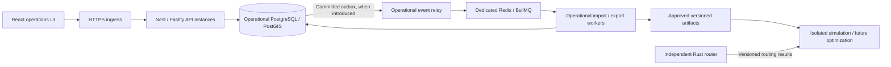

# Operational architecture and scaling design

Decision date: 2026-10-08. Accepted design: [ADR-0003](decisions/0003-scalable-operations-architecture.md).
This document describes implemented foundation boundaries and future workflow design.
OPS-01 and ARCH-01 are verified locally; [evidence](ARCHITECTURE_VERIFICATION.md) distinguishes
those results from pending workers and pilot deployment. Inventory and fulfillment now have
[OPS-02](INVENTORY_VERIFICATION.md) and [OPS-03](FULFILLMENT_VERIFICATION.md) evidence.

## Selected stack

| Area | Selection | Purpose and adoption timing |
|---|---|---|
| Backend | NestJS, strict TypeScript, supported Node.js LTS | A modular operational application with explicit composition and authorization |
| HTTP adapter | Fastify through Nest's official adapter | Implemented locally in ARCH-01; HTTP regression checks pass |
| Operational database | PostgreSQL with PostGIS | Transactions, tenant constraints, stock integrity and geographic queries |
| Query/migration layer | Native `pg`, parameterized SQL, checked-in SQL migrations | Retain; isolate SQL behind module-owned repositories and a unit of work |
| Web | React + TypeScript + Vite | Independently deployable operations SPA; static assets can use a CDN |
| Web navigation/data | React Router + TanStack Query | Implemented locally: lazy feature routes and session-scoped server state |
| Public API | Versioned REST + generated OpenAPI contract | Implemented locally: generated specification/wire types and typed fetch client |
| Operational jobs | Separate Node worker; BullMQ + dedicated Redis | Introduce with the first durable background workflow, before large imports/exports |
| Artifacts | S3-compatible object-storage adapter | Introduce with exports/snapshots; bounded local adapter for development |
| Telemetry | Structured logs, OpenTelemetry traces and metrics | Begin baseline instrumentation in ARCH-01; deployment backend chosen with hosting |
| Workspace | pnpm workspaces and package export boundaries | Retain within this repository; surrounding repositories stay independent |

Nest supplies feature modules with explicit exported providers and an official Fastify
adapter. That supports this design, but its framework benchmarks do not establish our
database-backed capacity. Fastify-specific hooks/plugins and response handling must replace
the former Express assumptions; ARCH-01 regression checks cover these paths. [Nest modules](https://docs.nestjs.com/modules),
[Nest Fastify adapter](https://docs.nestjs.com/techniques/performance).

React's documentation identifies routing, data fetching and code splitting as additional
SPA responsibilities. We choose React Router and TanStack Query for those responsibilities;
route loaders and queries must share one fetch/cache policy. Server rendering can be added
to a future public-facing application if that product needs it.
[React application patterns](https://react.dev/learn/build-a-react-app-from-scratch),
[TanStack Query](https://tanstack.com/query/latest/docs/framework/react/overview).

## Operational ownership and runtime topology

Keep operational domains together in a modular monolith. Its API can have several identical
stateless instances; background workers are separate deployments using the same reviewed
operational application code. Deployment count does not determine domain ownership.



This is a target diagram. Redis, outbox, operational workers, object storage, load balancing
and planning integration are not implemented by OPS-01 or by this architecture decision.
Operational workers receive only the permissions their workflows require. Planning workers
receive approved immutable artifacts and planning credentials; operational credentials
never cross that boundary. The existing marketplace remains retired and independent.

| Module | Owns | Public interactions |
|---|---|---|
| Identity/tenancy | Actor identity, organization scope, permissions | Authenticated actor/context; authorization decisions |
| Facilities | Warehouses/depots, location provenance, business zones | Validated facility references and network queries |
| Catalog | SKUs, units and quantity precision | Validated stocked-article references |
| Inventory | Movement ledger, balances, reservations, reconciliation | Receive/reserve/release/consume commands and stock queries |
| Fulfillment | Demand, allocation, picking/packing | Commands coordinating fulfillment and inventory |
| Shipping/distribution | Shipments, stops and operational transport progress | Shipment state transitions and observed evidence |
| Integrations | Imports/exports, source mapping, job and artifact lineage | Calls owning modules through their published commands |
| Audit | Transactional operational audit records | Append within the caller's transaction; authorized queries |

Identity, facilities, catalog, inventory, fulfillment, shipping and transactional audits exist locally.
[Inventory rules and transaction evidence](INVENTORY.md) define the implemented stock commands.
Introduce the other modules with working vertical slices. Routing algorithms stay in
osm-pathfinder; deterministic simulation stays in logistics-sandbox; future solving stays
in distribution-intelligence. Their serialized contracts include version and provenance.

## Folder structure

The following is the adopted layout, not a listing of existing folders. Create a folder when
its first implementation needs it. The separate operational library lets future API and
worker entry points share use cases without importing one application into another.

```text
supply-chain-platform/
  apps/
    api/src/
      main.ts                         # process bootstrap
      app.module.ts                   # Nest composition root
      modules/
        identity/                     # HTTP guard, context controller, Nest wiring
        facilities/                   # controller, DTOs, Nest wiring
        catalog/                      # controller, DTOs, Nest wiring
        inventory/                    # implemented ledger/reservation slice
        fulfillment/                  # demand/allocation/pick/pack HTTP or web feature
        shipping/                     # shipment HTTP commands
      transport/http/                 # exception mapping, headers, request context
      health/                         # liveness/readiness endpoints
    web/src/
      main.tsx                        # mount only
      app/                            # routes, providers, shell, session lifecycle
      features/
        identity/                     # connection/session views
        facilities/                   # pages, forms, queries
        catalog/                      # pages, forms, queries
        inventory/                    # implemented ledger/reservation slice
        fulfillment/                  # demand and shipping operator workflow
      shared/                         # reused UI and browser helpers only
    worker/src/                       # future operational jobs; independent process
      main.ts
      handlers/
  packages/
    operations/src/                   # backend-only application library
      modules/
        facilities/
          public.ts                   # published use cases, input/result types
          domain/                     # pure rules and value types
          application/                # commands/queries and required ports
          infrastructure/             # PostgreSQL repository and row mapping
        identity/                     # same boundaries where useful
        catalog/
        audit/
        inventory/                    # ledger/reservation owner
        fulfillment/                  # demand and allocation owner
        shipping/                     # shipment progress/evidence owner
      platform/                       # unit of work, config, clock, telemetry adapters
    contracts/
      openapi/v1.json                 # generated and reviewed HTTP specification
      src/generated/v1.ts             # generated HTTP wire types
      src/events/v1/                  # explicit serialized job/export/event schemas
    api-client/src/                   # typed fetch client consumed by web
  database/migrations/                # chronological immutable applied SQL
  tests/                              # cross-module HTTP/database/contract scenarios
  scripts/                            # local checks, migration/test tooling
  docs/
    ARCHITECTURE.md
    decisions/
```

Each backend domain's rules are framework-independent TypeScript. Its application layer
coordinates rules, authorization and transactions through narrow ports. Infrastructure
implements SQL and external-service access. The API's controllers validate/map wire DTOs
to use-case inputs and map results/errors back to HTTP. Nest composition wires those pieces.
Small modules can start with a few files; a layer gets a directory when it contains code.

The same pattern extends to fulfillment/shipping/integrations. Shared folders contain
small, demonstrated cross-cutting primitives. Avoid a generic CRUD base repository or a
catch-all shared business service; inventory has transaction rules of its own.

## Boundaries to enforce in code and CI

1. `domain` imports pure value/rule code. It cannot import Nest, PostgreSQL, HTTP, React or
   queue libraries. `application` imports domain code and declared ports.
2. Another module may import only the owning module's published entry point. Its tables,
   repositories and private entities remain internal. Define an acyclic dependency graph;
   coordinating use cases live above the modules they call.
3. Applications compose packages. Packages never import `apps/*`. Web imports the client,
   serialized contracts and browser-safe UI; it cannot import operational backend code.
4. An explicit tenant actor is required at use-case entry. Public HTTP input cannot select
   tenant scope. Repository work runs in a scoped unit of work, including audit insertion.
5. Add package exports, TypeScript project references and checked import restrictions in
   ARCH-01. CI must fail on prohibited imports or stale generated contracts.

## Transactions, database and tenant isolation

Inventory is an append-only movement ledger with transactionally maintained balances and
reservations. One stock-changing command commits its ledger, balance/reservation changes,
idempotency result and audit atomically. Fulfillment/shipment orchestration uses the owning
inventory command in the same unit of work when atomicity requires it. Cross-module SQL
mutations are forbidden; repositories can join through approved query interfaces/views.

The PostgreSQL client and transaction belong to the unit of work. Modules must not open a
second connection or commit an inner transaction while participating in a command. Native
`pg` requires all statements in a transaction to use the same client.
[node-postgres transactions](https://node-postgres.com/features/transactions).

Choose a consistent stock-key lock order, atomic constraints and bounded retries for
retryable concurrency failures. Idempotency is tenant-scoped and checks the normalized
command fingerprint. Money uses minor units/currency; quantity arithmetic uses bounded
decimal precision or scaled integers with explicit units. Use strings on the wire when
values exceed safe JavaScript numeric representation. Publish these representations with
OPS-02 rather than introducing floating-point stock arithmetic.

Retain tenant-scoped keys/foreign keys, server authorization and forced row policies.
Set tenant context transaction-locally on the checked-out client. RLS supplements application
authorization; a SQL-injection or compromised application identity is a wider trust failure.
Before pilot deployment, split the current migration-owning account into a migration identity
and a restricted runtime identity with no DDL ownership. PostgreSQL owners can change row
policies, and superuser/BYPASSRLS roles bypass them.
[PostgreSQL row security](https://www.postgresql.org/docs/18/ddl-rowsecurity.html).

SQL migrations remain centrally ordered and checksum-pinned. New schema evolution uses
additive changes, bounded backfills and a later cleanup after compatible application rollout.
Some future indexes/backfills require migration steps outside a transaction; extend the
runner explicitly before using those operations. Do not rewrite applied migration 001.

## Contracts, frontend and jobs

The canonical HTTP wire definition is the Nest request/response DTO metadata and its
generated OpenAPI specification, reviewed in the repository. Generate the web client/types
from that specification; do not hand-maintain a second set of HTTP interfaces. Runtime DTO
validation and domain checks still execute on the server. Contract tests verify error
responses, authentication, identifiers, units, dates and compatibility.
Nest can emit an OpenAPI document as a saved artifact.
[Nest OpenAPI](https://docs.nestjs.com/openapi/introduction).

Keep `/api/v1` compatible; use additive fields or a new version for breaking changes.
Separate HTTP DTOs, persistence rows and domain models. Serialized event/export schemas
have their own version and runtime validation. ARCH-01 replaced handwritten HTTP contracts
with generated v1 wire types; the client derives requests/responses from those types.

Web routes load feature bundles on demand. List endpoints expose bounded cursor pagination;
filters/sorting execute in indexed server queries. Table virtualization is introduced for
measured rendering pressure. TanStack Query handles remote state; component state handles
local form/UI state. Query keys include the authenticated tenant and session identity; abort
requests and clear the previous cache on disconnect or identity change. Secrets never enter
query keys, URLs or logs. Retry policy must respect command idempotency and unconfirmed writes.
Cached availability remains a display value; the server authorizes every reservation.

Long imports, exports and reports are durable jobs with status, bounded concurrency,
idempotency, retries, cancellation and failed-job inspection. Introduce a PostgreSQL outbox
when a committed operation must trigger a job/event: insert the event in the business
transaction and relay it afterward. Consumers tolerate duplicate delivery and check tenant
scope; per-entity sequence/version handles ordering. This avoids a commit-to-queue gap.
[Transactional outbox guidance](https://docs.aws.amazon.com/prescriptive-guidance/latest/cloud-design-patterns/transactional-outbox.html).

BullMQ is the selected operational queue adapter when that workflow arrives. Use dedicated
Redis, durable job metadata and a tested persistence/recovery policy. Queue state and caches
do not authorize stock movements. CPU-heavy Node tasks run in bounded separate processes;
simulation/optimization use their independent repositories and service identities. Node's
event-loop guidance supports offloading substantial computation, and BullMQ offers isolated
processors. [Node event-loop guidance](https://nodejs.org/en/learn/asynchronous-work/dont-block-the-event-loop),
[BullMQ isolated processors](https://docs.bullmq.io/guide/workers/sandboxed-processors).

## Scaling and operational evidence

Scale against measured bottlenecks. Stateless APIs must not depend on local sessions,
process-owned jobs or local durable files. Configure timeouts/body limits, graceful shutdown
and bounded in-flight work. Background workers scale by queue backlog and database capacity;
API instances scale by measured latency/utilization and dependency headroom.

Connection capacity is global: `API instances * API pool + workers * worker pool + admin
headroom` must fit the database budget, including rollout overlap. The default API
pool of eight is a local starting point, configurable through DB_POOL_MAX (1–100).
Worker concurrency requires deployment configuration when workers are introduced; PgBouncer is an option after compatibility/load testing.
[node-postgres pool sizing](https://node-postgres.com/guides/pool-sizing).

Measure tenant-filtered query plans and indexes, query/lock wait time, pool waits, event-loop
lag, request latency/errors and worker backlog. Move reporting to aggregate views and then
read replicas or separate analytics storage when measured demand warrants it. Replicas and
caches must expose freshness and cannot decide authoritative stock availability. Contended
writes for the same stock key still require coordination; adding API instances cannot remove
that constraint. Partition historical ledgers only after volume/query/maintenance evidence.

OpenTelemetry provides JavaScript instrumentation; the project must still implement redaction,
safe correlation IDs, bounded-cardinality metrics and a collection/export backend.
[OpenTelemetry JavaScript](https://opentelemetry.io/docs/languages/js/).

Before pilot use, demonstrate OIDC/permission enforcement, runtime/migration role separation,
backups/restores and deployment health. Hosting starts with containers and managed PostgreSQL
where available. Kubernetes or a message-stream platform is a later hosting/workload decision.
Dependencies receive supported-version/security updates; pinned versions are reproducible
build inputs, not a promise to freeze them forever.

The local master-data baseline establishes no production capacity or SLO. Benchmarks must record
hardware, dataset/cardinality, tenant skew, concurrency, request mix and p50/p95/p99/error rate.
OPS-02 adds concurrent stock/idempotency tests and a representative hot-stock workload.
Load tests must preserve correctness while measuring capacity. Agree pilot SLOs using these
results. Extract a module into a separate service only for a measured independent resource,
release or isolation need and a documented plan for its transaction boundary.

## Immediate sequence and current limitations

1. ARCH-01: restructure existing code, adopt Fastify, generate HTTP contracts/client, add
   frontend routes/queries, pagination, import-boundary checks and basic performance evidence.
2. OPS-02: implement the ledger/reservation slice using these boundaries and concurrency rules.
3. OPS-03 and DATA-01: add fulfillment and durable import/export workers/outbox when used.
4. DATA-02 and existing Phase 0 gates: integrate approved snapshots with independent planning.
5. Pilot gates: identity lifecycle, least-privilege deployment, recovery, workload SLOs.

ARCH-01 implements the foundation layout, Fastify, generated contracts, frontend routes/queries,
pagination, import checks and baseline instrumentation. Applied migration 001 remains unchanged.
See [ARCH-01 evidence](ARCHITECTURE_VERIFICATION.md) and [OPS-02 evidence](INVENTORY_VERIFICATION.md).
Inventory and fulfillment/shipment workflows now pass locally; see [OPS-03 evidence](FULFILLMENT_VERIFICATION.md).
Bounded synchronous source mapping/CSV exchange passes locally; see [DATA-01 evidence](DATA_EXCHANGE_VERIFICATION.md).
Workers/outbox, Redis, object storage, OpenTelemetry export and pilot controls remain pending.
